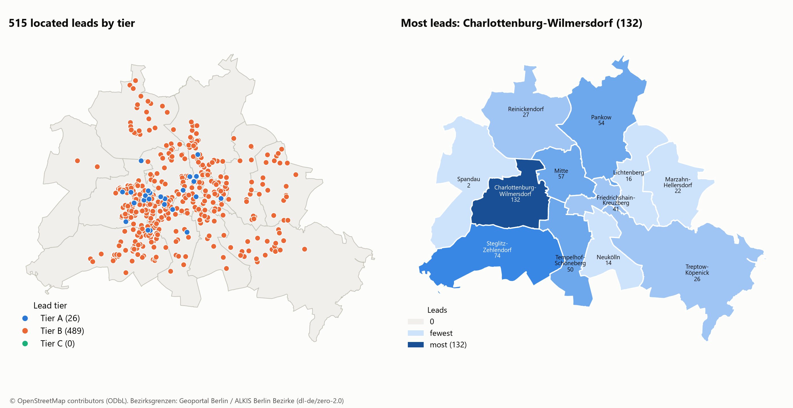
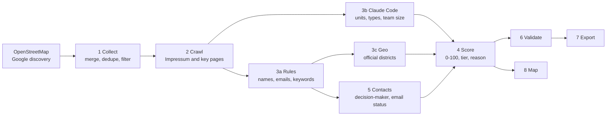

# Berlin Hausverwaltung Lead Engine

**Finds property management companies in a city, works out which ones are worth calling, and shows where they are.**

Built as a case study for a metering service provider, whose main customers are Hausverwaltungen. Every enriched value carries a source URL and a confidence label. If a fact is not published, the sheet says `not stated`. Nothing is guessed.




**[Open the interactive map](https://vermillion-cocada-73949e.netlify.app)**

---

## Latest run

| Measure | Result |
|---|---|
| Companies listed | 535 (26 Tier A, 509 Tier B) |
| Named decision-maker | 70 % |
| Personal emails | 29 published on company websites, 16 inferred and labelled unverified |
| Placed in an official district | 515 |
| Google usage | 297 of 1,000 free calls, EUR 0 |
| Validation | 24 of 24 judged fields correct in a 5-row manual check; 94 % in a 25-row AI re-check, before fixes |

The manual sample is small and the AI re-check is not independent, so treat both as indicative.


## What you get

| Output | What it is |
|---|---|
| `hausverwaltungen_berlin.xlsx` | Six tabs: `Leads`, `Top 25`, `KPI Definitions`, `Method & Sources`, `Validation`, `Excluded`, ready for Google Sheets |
| `lead_map.html` | Interactive map with tier layers, marker clusters, popups and lead counts per district |
| `lead_map.png` | Static version of the map for slides |
| `district_summary.csv` | Leads, tiers and mean score for each of the 12 Berlin districts |
| `run_summary.md` | Counts per stage, run time and requests per service, as proof of the EUR 0 budget |

## How it works

Each stage reads files and writes files, so any stage can be rerun on its own.



Contacts run before scoring because being able to reach someone is itself a scored KPI.

| Stage | What happens |
|---|---|
| **Collect** | Queries OSM and, with a key, Google Places. Merges by domain, then name and postcode, then fuzzy name. Non-targets such as competitors, caretakers and estate agents are moved to `Excluded` with a reason, never silently dropped. |
| **Crawl** | Fetches the home page, Impressum and up to 3 relevant pages per company. Respects robots.txt, limits the rate per domain and caches on disk. |
| **Rules** | Extracts managers, emails, phones, register numbers and legal form with code. Detects metering providers, software, portals, remote reading and job ads. |
| **Claude Code** | Code pulls numbered candidate lines for units, staff, founding year and cities, and Claude Code picks the right one. Code then copies the quote, and a validator rejects any value whose quote does not appear on the page. |
| **Geo** | Places each company inside an official district polygon. The polygon test also catches addresses that pass the postcode check but lie outside Berlin. |
| **Score** | Weights live in `config/scoring.yaml`. A missing KPI gets a neutral value and lowers `data_completeness`, so unknown never counts as bad. |
| **Validate** | Automatic checks, plus a fixed 30-row sample for manual review and a per-field accuracy report. |

## What makes a good lead

| KPI | Weight | Why it matters |
|---|---:|---|
| Units managed | 30 | Main driver of meter count and revenue |
| Management type | 15 | WEG and rental management need heating and water cost billing |
| Employees | 10 | Proxy for portfolio size and buying process |
| Remote reading signal | 10 | Shows the retrofit topic is live |
| Metering provider named | 10 | Confirms external metering and reveals the competitor |
| Digital maturity | 10 | Digital firms tend to adopt new providers faster |
| Years in business | 5 | Stability, and possible legacy contracts |
| Reachability | 5 | Sales can only act on a lead it can reach |
| Hiring signal | 3 | Growth |
| Locations and other cities | 2 | Scale |

Tiers: **A** at 70 or above, **B** from 40 to 69, **C** below 40. Cooperatives and municipal landlords are capped at Tier B, because they manage their own housing. The weights are reasoned judgement, because no win/loss data was available to calibrate them.

The urgency signal comes from [§ 5 Abs. 3 HeizkostenV](https://www.gesetze-im-internet.de/heizkostenv/__5.html): non-remote-readable devices must be retrofitted or replaced by 31 December 2026, with exemptions. A website mentioning remote reading shows awareness. It does not prove the company still has to convert.

## Quick start

Requires Python 3.11 or newer (developed on 3.14).

```bash
python -m venv .venv
.venv\Scripts\activate          # macOS/Linux: source .venv/bin/activate
pip install -e .
pytest
```

The Google key is optional. Without it the source is skipped and everything else still runs:

```bash
cp .env.example .env            # then add GOOGLE_MAPS_API_KEY
```

## Running it

```bash
# Stages before the Claude Code step
python -m leadengine run --city Berlin --stages collect,crawl,rules

# Stage 3b, done in Claude Code (see .claude/skills/lead-kpi-extract)
python -m leadengine llm brief
python -m leadengine llm apply
python -m leadengine llm validate

# Everything after it
python -m leadengine run --city Berlin --stages geo,contacts,score,validate,export,map

# After filling in outputs/validation_sample.xlsx
python -m leadengine validation-report
```

- Any stage runs on its own, for example `python -m leadengine crawl`.
- Add `--limit 10` for a dry run.
- View the map over HTTP so the background tiles load: `python -m http.server 8000 --directory outputs`.
- To add a city, create a file in `config/cities/` with its bounding box, postcode range and boundary source. Only Berlin is implemented and tested so far.

**Run time.** About 40 minutes on the first run for 1,000 candidates (collect 9, crawl 18, geocoding 13), plus the Claude Code review. Reruns from cache take seconds.

## Project layout

```text
.claude/      reusable skill for the Claude Code KPI step
config/       city settings, scoring weights, keywords, pipeline limits
src/leadengine/
  sources/    OpenStreetMap and Google Places
  stages/     one module per pipeline stage
  schemas.py  strict schema for the Claude Code step
  ledger.py   request counts and budget guard
specs/        requirements, design and task list
tests/        offline tests using saved HTML fixtures
scripts/      the original collection script
data/         raw, interim and processed files (not in the repo)
outputs/      generated deliverables
```

## Why it costs EUR 0

| Service | Use | Limit |
|---|---|---|
| OpenStreetMap / Overpass | One cached query | Free, about 10,000 requests per day guideline |
| Geoportal Berlin WFS | District polygons, downloaded once | Open data |
| Nominatim | Addresses without coordinates | Free, at most 1 request per second, cached |
| Company websites | Direct crawl | Own rate limit |
| Google Places (optional) | Candidate websites only | 1,000 free calls per month for these fields |
| Claude Code | KPI reading | Existing Pro plan, no API charge |

The original Google script could reach 4,032 calls in the worst case, about USD 106. `ledger.py` counts every attempt before it is sent and stops at 900 per month. A daily quota in Google Cloud is the second safeguard. A full Google run also stays locked until `google.full_run_confirmed` is set to `true` in `config/pipeline.yaml`.

## Scaling with a paid LLM

Stage 3b sits behind a small interface: `backend = claude_code | ollama | anthropic_api`. Only `claude_code` is implemented today. An API backend would replace the manual batch step while keeping the same schema, validator and resume logic. That would allow a scheduled refresh, CRM sync and alerts when a company's signals change.

## Limits

- **Coverage depends on Google.** OSM alone found about 80 usable companies in Berlin. With Google discovery the list reached 535 verified companies, which is a minimum and not the full market.
- **Many KPIs are unpublished.** Most firms do not state unit counts, so many cells read `not stated`.
- **Most scores rest on partial data.** Average completeness is 21.5 %, so Tier B mixes average leads with leads that are simply unknown.
- **Companies that publish more can rank higher**, whether or not they are better leads.
- **Personal emails are rare.** Most Impressum pages list only a general address. `pattern_inferred` addresses are unverified.
- **A missing keyword proves little.** Only up to 5 pages per company are read, so absence is recorded as `not_mentioned`.
- **Rule extraction makes mistakes** on unusual pages. Low-confidence names are flagged `name_needs_review`, and field accuracy is in `validation_report.md`.

## Data, licences and legal notes

- OSM data is © OpenStreetMap contributors under the [ODbL](https://www.openstreetmap.org/copyright). OSM-derived fields in the output stay under that licence.
- District boundaries are from Geoportal Berlin, ALKIS Berlin Bezirke, under dl-de/zero-2.0.
- Google's terms restrict saving Places content and using it on non-Google maps. In `discovery_only` mode, Google supplies candidate websites only, and published names, addresses and map coordinates come from company websites, OSM or Nominatim. The candidate list still originates from Google, so this reduces the conflict but does not remove it.
- The VDIV Berlin-Brandenburg directory is not used, because its Impressum limits copies to private, non-commercial use.
- **GDPR:** only publicly listed business contact data is collected. Crawled pages and files with personal contact data are excluded from this repository.
- **UWG § 7:** cold email is restricted in Germany. First contact should be by phone or another compliant channel.

This is a technical reading of these terms, not legal advice.
