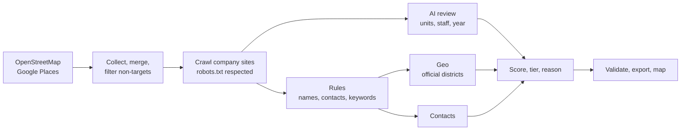

# Approach: Finding and qualifying Berlin Hausverwaltungen

## Result in one view

| | |
|---|---|
| Companies listed | **535** real Berlin property management companies and housing companies |
| Tier A / B / C | 26 / 509 / 0 |
| Named decision-maker | 70 % (377 companies) |
| Personal email published on the company's site | 29 companies (5 %), plus 16 inferred and labelled as unverified |
| LinkedIn | Profile found for 7 Tier A contacts, search link for every named contact |
| Field accuracy | 24 of 24 judged fields correct in the manual check (5 rows); 94 % in a 25-row AI re-check |
| Placed in an official Berlin district | 515 |
| Cost | EUR 0 |

Every enriched value has a source URL and a confidence label. Where a company does not publish a fact, the sheet says `not stated`. Nothing is estimated.

## How it was built

The funnel, from raw results to the final list:

| Step | Count |
|---|---:|
| Unique places from Google | 1,363 |
| Rows from OpenStreetMap | 94 |
| Companies after deduplication | 1,356 |
| Candidates after name filters | 1,000 |
| Websites crawled successfully | 868 |
| **Final leads** | **535** |

Most of the drop comes from checking each website: many search results are estate agents, tradespeople or service firms, or sit outside Berlin.

## Sources and tools

| Source | Used for | Terms |
|---|---|---|
| OpenStreetMap (Overpass) | Discovery and coordinates | ODbL, attribution in the sheet |
| Google Places API | Candidate websites only | See note below |
| Company websites | Names, addresses, contacts, KPIs | robots.txt respected |
| Geoportal Berlin | Official district boundaries | dl-de/zero-2.0 |
| Nominatim | Locating Impressum addresses | 1 request per second, cached |

**Tools:** Python (requests, BeautifulSoup, trafilatura, pandas, geopandas, folium, openpyxl) and Claude Code.

**Deliberately not used:** the VDIV Berlin-Brandenburg directory (its Impressum limits copies to private, non-commercial use), LinkedIn scraping, SMTP email probing and paid enrichment tools.

**Google note:** Google's terms restrict saving Places content and showing it on non-Google maps. Google therefore supplied candidate websites only. Published names, addresses and map positions come from company websites, OpenStreetMap or Nominatim, and stored Google responses were deleted after the run. The candidate list still originates from Google, so this reduces the conflict but does not remove it.

## Automation and the EUR 0 design

One command reruns each stage, and the city is a config value. Stages read and write files, so any stage can be repeated alone.

| Service | Requests | Free limit |
|---|---:|---|
| Google Text Search | 297 | 1,000 per month |
| OpenStreetMap Overpass | 1 | About 10,000 per day |
| Nominatim | 698 | 1 per second |
| Geoportal Berlin | 1 | Open data |
| Company websites | 4,562 | Own rate limit |

The original Google script could have reached 4,032 calls in the worst case, about USD 106. A request counter now stops at 900 calls per month, and the full run needs an explicit unlock.

**AI cost control:** reading every page for 610 companies would have taken about 3.7 million characters. Code extracted candidate lines instead, about 90,000 characters, and AI only chose the correct line. Code then copied the exact quote, so evidence cannot be invented or mistyped.

## KPI logic

| KPI | Weight | Why it qualifies a lead | Filled |
|---|---:|---|---:|
| Units managed | 30 | Main driver of meter count and revenue | 16 % |
| Management type | 15 | WEG and rental need heating and water billing | 52 % |
| Employees | 10 | Portfolio size and buying process | 7 % |
| Remote reading signal | 10 | Shows the retrofit topic is live | 1 % |
| Metering provider named | 10 | Confirms external metering and the competitor | 1 % |
| Digital maturity | 10 | Digital firms adopt new providers faster | 16 % |
| Years in business | 5 | Stability and legacy contracts | 23 % |
| Reachability | 5 | Sales can only act on a lead it can reach | 70 % |
| Hiring signal | 3 | Growth | 22 % |
| Locations and cities | 2 | Scale | low |

- **Urgency:** § 5 Abs. 3 HeizkostenV requires non-remote-readable devices to be retrofitted or replaced by 31 December 2026, with exemptions. A mention of remote reading shows awareness. It does not prove the company still needs to convert.
- **Missing data:** an unknown KPI gets a neutral value and lowers `data_completeness`. Unknown never counts as bad.
- **Tiers:** A at 70 or above, B from 40 to 69, C below 40. Cooperatives and municipal landlords are capped at Tier B, because they manage their own housing and buy differently from a Hausverwaltung.
- **Competitors** such as Objektus are excluded.

## Validation

**Automatic:** duplicates, Berlin postcode range, URL and email format, website reachability, plausible number ranges, and a check that each AI-sourced value's quote appears on the page. A map check places each address inside the official city boundary.

A random sample of 30 rows (fixed seed) was then reviewed field by field, in two separate checks.

| Check | Rows | Correct | Wrong | Not verifiable | Accuracy |
|---|---:|---:|---:|---:|---:|
| Manual check by a person | 5 | 24 | 0 | 15 | 100 % |
| AI re-check of saved pages | 25 | 111 | 7 | 82 | 94 % |

- **Read these results with care.** The manual check covers only 5 rows, too few to prove a rate. The AI re-check is not independent, because the same kind of tool built the list.
- **All 7 wrong values were structural:** company names with stray text (5, accuracy 77 %) and person names with stray role words (2, accuracy 88 %). Those rules were fixed afterwards, so the figures above show accuracy before the fixes.
- **"Not verifiable" fields** are mostly empty values, and are excluded from accuracy. Accuracy on units managed rests on only 4 values.

## Limits

- **Coverage is not complete.** 535 is a verified minimum, not the size of the market. Companies without a usable website could not be confirmed and are not listed.
- **Most scores lean on partial data.** Average completeness is 21.5 %, because few firms publish unit counts. Tier B therefore mixes average leads with leads that are simply unknown, which is why no company landed in Tier C.
- **Remote reading and metering providers are rarely stated on websites** (about 1 % each), so these signals are useful where present but cannot rank the whole list.
- **Weights are reasoned judgement.** There was no win/loss data to calibrate them.
- **Personal emails are rare.** Most Impressum pages list a general address. Inferred addresses are unverified.
- **Automatic name extraction makes mistakes** on unusual pages. Low-confidence names are flagged `name_needs_review`.

## Legal notes

Only publicly listed business contact data was collected. Cold email is restricted in Germany under UWG § 7, so first contact should be by phone or another compliant channel. This is a technical reading of the rules, not legal advice.

## What I would build next at Heidi

1. **Calibrate the score** on Heidi's won and lost deals, replacing judgement-based weights.
2. **Scheduled refresh** that rechecks companies weekly and alerts sales when a signal changes, such as a new job ad or a metering mention.
3. **CRM sync** that creates or updates leads directly, with source links attached.
4. **Direct phone qualification data:** unit counts and contract end dates, which websites rarely publish.
5. **Paid LLM backend** behind the existing interface, so runs need no manual step and can extend to other cities.
