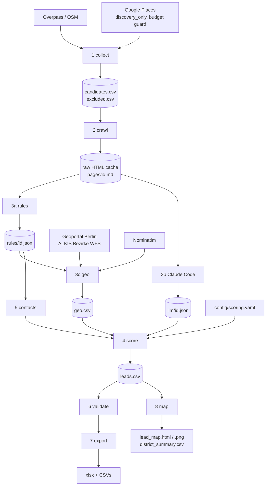

# Design: Berlin Hausverwaltung Lead Engine

Status: **Draft, awaiting approval** (Phase 0, drafted 2026-11-08)

Facts marked "verified 2026-11-08" were checked against the primary source on that date.

## 1. Architecture

A linear pipeline of independent stages. Each stage reads files and writes files, so any stage can be rerun alone. The city is a config value.



CLI order: `collect, crawl, rules, [llm by Claude Code], geo, contacts, score, validate, export, map`. Stage numbers follow the prompt; contacts runs before score.

## 2. Folder structure

```text
proptech-lead-agent/
  CLAUDE_CODE_PROMPT.md
  README.md
  pyproject.toml
  requirements.txt
  .env.example                  # GOOGLE_MAPS_API_KEY only, optional
  .gitignore                    # data/, outputs/*.xlsx, outputs/*.csv, .env
  config/
    cities/berlin.yaml          # bbox, postcode range, boundary source, Google queries
    scoring.yaml                # weights, bins, neutral values, labels, angles
    keywords.yaml               # providers, software, non-target rules, platform domains
    pipeline.yaml               # crawl limits, Google mode and budget, VDIV switch
  src/leadengine/
    __main__.py  cli.py  config.py  ledger.py  http_client.py  normalize.py  schemas.py
    stages/
      collect.py                # merge, dedup, non-target filter
      crawl.py  rules.py  llm.py  geo.py  contacts.py  score.py  validate.py  export.py  map.py
    sources/
      osm.py
      google_places.py          # refactored from collect_hausverwaltungen.py
    llm_backends/
      base.py  claude_code.py   # ollama and anthropic_api documented, not implemented
  scripts/validate_llm_batch.py
  data/
    raw/{osm,google,html,geo}/  interim/{pages,rules,llm}/  processed/
  tests/fixtures/  tests/test_*.py
  specs/  requirements.md  design.md  tasks.md
  outputs/  approach.md  run_summary.md  lead_map.html  lead_map.png  district_summary.csv
```

`collect_hausverwaltungen.py` moves to `src/leadengine/sources/google_places.py` during task 2.2.

## 3. Sources and what we may do with them

| Source | Role | Limits and licence | Status |
|---|---|---|---|
| OSM via Overpass | Primary discovery, coordinates | About 10,000 requests and 1 GB per day guideline. ODbL: attribution required, share-alike applies to derived data | Use |
| Google Places (New) | Website discovery only | See section 4 | Default `discovery_only`, needs decision Q1 |
| VDIV Berlin-Brandenburg | Member list | robots.txt permits. Impressum limits downloads and copies to private, non-commercial use and requires written permission for reproduction. A search found no public member directory | **Disabled** unless written permission is obtained |
| Company websites | Name, address, contacts, KPIs | robots.txt respected; only short evidence quotes are published | Use |
| ALKIS Berlin Bezirke WFS | District polygons | `https://gdi.berlin.de/services/wfs/alkis_bezirke`, layer `alkis_bezirke:bezirksgrenzen`, `application/json` output, licence dl-de/zero-2.0 (verified 2026-11-08) | Use |
| Nominatim | Geocode Impressum addresses | Maximum 1 request per second, identifying User-Agent, attribution; smaller one-time bulk tasks may be permissible in a single thread (verified 2026-11-08) | Use, cached |

## 4. Google Places: cost and terms

### 4.1 Cost (verified 2026-11-08)

The script's field mask includes `websiteUri`, `nationalPhoneNumber`, `rating` and `userRatingCount`. Each triggers **Text Search Enterprise**, which has **1,000 free calls per month**, then USD 35.00 per 1,000.

| Scenario | Calculation | Requests | Against 1,000 free |
|---|---|---|---|
| Minimum | 4 queries x 16 tiles x 1 page | 64 | Fits |
| No tile splits, all pages | 64 x 3 | 192 | Fits |
| Worst case, script as written | 64 x 21 searches x 3 pages | **4,032** | **Over by 3,032, about USD 106** |

The real figure is unknown until a dry run. The script has no ceiling, so it cannot be run as is under a EUR 0 budget.

Controls:

1. `ledger.py` counts every HTTP attempt per month and refuses to pass `monthly_request_budget` (900, leaving margin for the dry run).
2. Tiles run centre-outward, so if the budget runs out the sparse edge of the city is what gets lost.
3. Tile splits run only while budget remains.
4. **You** set a daily quota on Text Search in Google Cloud before the run, and set it to 0 afterwards. A daily cap alone does not prevent a monthly overrun across several days, which is why both controls exist.
5. Confirm Text Search Enterprise usage is 0 for the month before starting, as the free cap is per SKU, per month.

### 4.2 Terms (verified 2026-11-08)

The prompt's plan conflicts with Google's terms in three places. This is my reading of the text, not legal advice.

| Plan in prompt | Google text |
|---|---|
| Save names and addresses to CSV, Excel and a shared sheet | Terms 3.2.3(a): will not "copy and save business names, addresses, or user reviews" |
| Plot Places on a Folium/OSM map | Terms 3.2.3(e): will not "display or use Places content on a non-Google Map" |
| Point-in-polygon on Places coordinates | Places policies list it as an example under "don't create content based on Google Maps Content" |

Place IDs may be stored indefinitely. Coordinates may be cached for up to 30 days, but that does not lift the restrictions above.

**Proposed default, `google.mode: discovery_only`:** Google supplies candidate websites only. Published name, address and phone are rebuilt from the company's own Impressum, and coordinates come from OSM or Nominatim. Google rating and review count are dropped from the output and from scoring. Rows that cannot be rebuilt from a non-Google source are counted but not listed. Google responses stay local, are gitignored, and `leadengine purge-google` deletes them when the run ends.

This reduces the conflict without removing it, because the candidate list still originates from Google. `approach.md` will say so plainly. See Q1 for alternatives.

## 5. GIS design

**Why it matters:** the map is more than decoration. The spatial join is the accurate Berlin check, and districts give a territory view for sales.

- **Boundary source:** the WFS serves EPSG:25833 by default. The stage reprojects that to WGS84 itself, which avoids the latitude/longitude axis-order ambiguity of requesting EPSG:4326 from WFS 2.0. The file is cached at `data/raw/geo/berlin_bezirke.geojson`. It has 12 districts; a test asserts this.
- **Why a polygon test as well as postcodes:** the range 10115-14199 is too coarse, for example 12529 is Schönefeld in Brandenburg. The postcode check stays as a QA flag, and the polygon decides.
- **Location order:** OSM coordinates, then Nominatim on the Impressum address, then `null`. `geo_precision` is `exact`, `street`, `postcode` or `none`, and postcode-level hits are excluded from district assignment.
- **Interactive map:** toggleable A/B/C layers, marker clusters, tier colours plus a tier letter in the marker so tier is not encoded by colour alone, and a choropleth with district tooltips.
- **Basemap:** OSM tiles, with attribution always visible. The OSM tile policy expects a valid Referer, so opening the file directly from disk may show blank tiles. The map is therefore served over HTTP (GitHub Pages, or `python -m http.server` locally), and the task's done-check confirms that tiles load. District polygons are embedded, so the map stays usable if tiles fail.
- **PNG:** two panels, tier points on districts and a lead-count choropleth. Polygons only, so no tile downloads.
- **Other cities:** `boundary:` in the city YAML names a WFS URL and layer. Only Berlin is implemented and tested now; other cities need their own boundary entry.

## 6. Data model: `Leads` columns

Fields marked † also have `<name>_confidence` (`high|medium|low`) and `<name>_source_url` columns. Evidence quotes are kept in `data/processed/evidence.csv`. Examples are fictional.

| Column | Type | Source | Example |
|---|---|---|---|
| `company_id` | str | Hash of domain, or name + postcode | `hv_3fa91c02de` |
| `company_name` † | str | Impressum, else OSM | `Musterhaus Verwaltung GmbH` |
| `legal_form` † | enum/null | Rules | `GmbH` |
| `website` | url/null | OSM, Google discovery | `https://musterhaus.example` |
| `domain` | str/null | Normalised website | `musterhaus.example` |
| `address` † | str/null | Impressum, else OSM | `Musterstr. 1, 10115 Berlin` |
| `postcode` † | str/null | Impressum, else OSM | `10115` |
| `district` | str/null | Spatial join | `Mitte` |
| `lat` / `lng` | float/null | OSM or Nominatim | `52.53` / `13.38` |
| `geo_source` | enum | Geo stage | `osm`, `nominatim`, `none` |
| `geo_precision` | enum | Geo stage | `exact`, `street`, `postcode`, `none` |
| `in_city_boundary` | bool/null | Spatial join | `TRUE` |
| `phone` † | str/null | Impressum, else OSM | `+49 30 000000` |
| `handelsregister_no` † | str/null | Rules | `HRB 000000 B` |
| `sources` | str | Collect | `osm;google_discovery` |
| `google_place_id` | str/null | Google (storable) | `ChIJ...` |
| `units_managed` † | int/null | Claude Code | `3200` |
| `management_types` † | list/null | Claude Code | `WEG;Miet` |
| `employees` † | int/null | Claude Code | `25` |
| `founding_year` † | int/null | Claude Code | `1998` |
| `years_in_business` | int/null | Derived | `28` |
| `berlin_locations` † | int/null | Claude Code, OSM | `2` |
| `other_cities` † | list/null | Claude Code | `Potsdam` |
| `digital_maturity` † | enum/null | Claude Code | `high`, `medium`, `low` |
| `owner_portal` † | enum | Rules | `mentioned`, `not_mentioned` |
| `software_mentioned` † | list/null | Rules | `casavi` |
| `metering_providers` † | list/null | Rules | `Techem` |
| `remote_reading_signal` † | enum | Rules | `mentioned`, `not_mentioned` |
| `hiring_signal` † | enum | Rules | `mentioned`, `not_mentioned` |
| `company_summary` † | str/null | Claude Code | `WEG manager in Mitte.` |
| `contact_name` † | str/null | Contacts | `Erika Mustermann` |
| `contact_role` | str/null | Contacts | `Geschäftsführerin` |
| `contact_email` † | str/null | Contacts | `e.mustermann@musterhaus.example` |
| `email_status` | enum | Contacts | `found_on_site` |
| `generic_email` | str/null | Rules | `info@musterhaus.example` |
| `linkedin_search_url` | url/null | Generated | LinkedIn people search URL |
| `linkedin_profile_url` | url/null | Manual, Tier A | empty |
| `xing_search_url` | url/null | Generated | XING people search URL |
| `lead_score` | int | Score | `78` |
| `lead_tier` | enum | Score | `A` |
| `score_reason` | str | Rule labels | `~3,200 units; WEG and rental; mentions remote reading` |
| `data_completeness` | float | Score | `72.5` |
| `first_contact_angle` | str | Config template | `Ask about the 31.12.2026 retrofit` |
| `website_reachable` | bool/null | Validate | `TRUE` |
| `crawl_status` | enum | Crawl | `ok`, `robots_blocked`, `timeout`, `error`, `no_website` |
| `qa_flags` | list/null | Validate | `postcode_mismatch` |
| `collected_at` | date | Collect | `2026-11-08` |

`Excluded` has these identity columns plus `exclusion_reason`. Google-only rows that cannot be rebuilt appear only as an aggregate count in `Method & Sources`.

Keyword confidence is `high` for a labelled match on the Impressum, `medium` for an explicit match on another page, and `low` for a weak heuristic match.

## 7. Extraction schema (Stage 3b)

```python
class Field(BaseModel, Generic[T]):
    value: T | None
    source_url: HttpUrl | None
    evidence_quote: str | None          # verbatim, max 200 chars
    confidence: Literal["high", "medium", "low"] | None
    # validator: if value is not None, then source_url, evidence_quote and confidence are required
    # validator: if value is None, then source_url and evidence_quote must also be None

class CompanyExtraction(BaseModel):
    model_config = ConfigDict(extra="forbid")
    company_id: str
    units_managed: Field[int]           # 1 to 500000
    management_types: Field[list[Literal["WEG", "Miet", "SE", "Gewerbe"]]]
    employees: Field[int]               # 1 to 20000
    founding_year: Field[int]           # 1850 to the current year
    other_cities: Field[list[str]]
    digital_maturity: Field[Literal["high", "medium", "low"]]
    company_summary: Field[str]         # max 200 chars
```

The validator also checks that each `evidence_quote` occurs in the company's `pages/<id>.md`, which catches invented values mechanically.

Batch flow: run `leadengine llm next-batch`, read the 20 listed page files, write `llm/<id>.json`, run the validator, and fix any failures. Priority order is number of sources, then page count, then keyword hits. Google review counts are not used under `discovery_only`.

## 8. Scoring

```text
lead_score = round(100 x sum(weight_k x s_k) / sum(weight_k))      s_k in [0, 1]
s_k = neutral value (0.5) when the KPI is missing
data_completeness = 100 x sum(weight_k for known KPIs) / sum(weight_k)
```

| KPI | Weight | s_k | Why it matters to Heidi |
|---|---:|---|---|
| Units managed | 30 | <100: .1; 100-499: .4; 500-1,999: .7; 2,000-9,999: 1; 10,000+: .8 | Main driver of meter count and revenue. Very large groups often buy centrally |
| Management type | 15 | WEG or Miet: 1; SE only: .6; Gewerbe only: .2 | WEG and rental need heating and water billing |
| Employees | 10 | <3: .2; 3-9: .5; 10-49: 1; 50+: .8 | Portfolio proxy and buying process |
| Remote reading signal | 10 | mentioned: 1; not mentioned: neutral | Shows the topic is live. It indicates awareness and may mean the firm has already converted, so it must not be read as proven need |
| Metering provider named | 10 | named: .7; not mentioned: neutral | Confirms external metering and reveals who to displace |
| Digital maturity | 10 | high: 1; medium: .6; low: .2 | Digital firms adopt new providers faster |
| Years in business | 5 | <3: .3; 3-9: .6; 10+: .8 | Stability; legacy contracts |
| Reachability | 5 | name + site email: 1; + inferred: .8; + generic: .6; name only: .5; no name: .1 | Can sales reach them? |
| Hiring signal | 3 | mentioned: 1; not mentioned: neutral | Growth |
| Locations and other cities | 2 | multiple: 1; single: .5 | Scale |

Google rating and reviews carry weight 0 under `discovery_only`.

- `not_mentioned` scores neutral and does **not** count as known data.
- The weights and bins are reasoned judgement. There is no Heidi win/loss data to calibrate them, and `approach.md` will say so.
- `first_contact_angle` comes from a config template keyed on the strongest signal, not free text.

**HeizkostenV (verified 2026-11-08):** § 5 Abs. 3 requires non-remote-readable devices installed by 1 Dec 2021 to be retrofitted or replaced by 31 Dec 2026, unless technically impossible in the individual case, disproportionately costly or an unfair hardship. Source: <https://www.gesetze-im-internet.de/heizkostenv/__5.html>. A keyword search of the Federal Government's reply BT-Drs. 21/4824 (17 Mar 2026) found no language about postponing it.

## 9. Validation

Automatic checks write `qa_flags`. The sample uses seed 42 and covers name, address, postcode, website, contact name, contact email, units and management type. Accuracy = correct / (correct + wrong), with "not verifiable" reported separately rather than counted as correct.

## 10. Error handling

| Situation | Behaviour |
|---|---|
| No Google key, or mode `off` | Skip, log, continue |
| Google budget reached | Stop Google, keep results, log the shortfall |
| Google 429/5xx | Up to 3 attempts with backoff, each counted in the ledger |
| Overpass 429/504 | Backoff with a single retry queue; cache on success |
| Website timeout or 5xx | Retry twice, then `crawl_status = timeout/error`; the row stays |
| robots.txt unreachable | Treat a 4xx as allow-all and a 5xx or timeout as disallow for this run |
| Invalid LLM JSON | Validator names the file and field; the batch is not done until it passes |
| Nominatim no result | `geo_precision = none`, row kept and counted as unlocated |
| WFS unavailable | Use the cached file; if none exists, map stage fails with a clear message and earlier stages stay valid |

## 11. Free-tier request estimates

| Service | Estimated requests | Limit | Cost |
|---|---:|---|---|
| Overpass | 1-2 | About 10,000 per day guideline | 0 |
| Google Text Search Enterprise | 1 for the dry run, then at most 900 by guard | 1,000 free per month | 0 if guard and cap are in place |
| Geoportal WFS | 1 | Open service | 0 |
| Nominatim | At most 1 per company lacking OSM coordinates; at most about 15 minutes for 800 | 1 per second | 0 |
| Website crawl | Up to about 6 per company including robots.txt | Our per-domain limit | 0 |
| Claude Code | About 2.4M characters of page text for 400 companies | Pro plan limits, exact allowance unknown | 0 extra |

Estimated CLI run time excluding stage 3b: 30-60 minutes on the first run, a few minutes when cached. To be measured and reported in `run_summary.md`.

## 12. Changes from the prompt

| Change | Why |
|---|---|
| Google limited to discovery; no Google data published or mapped | Google's terms, section 4.2. Pending Q1 |
| Google rating and reviews removed from scoring and prioritisation | Same reason |
| Request budget guard added | Worst case costs about USD 106 otherwise |
| VDIV disabled | Prompt says only if terms allow; the Impressum does not appear to |
| Contacts run before score | Reachability is a scored KPI |
| New geo stage; Nominatim added | GIS required, and Google coordinates cannot be used |
| Map promoted from bonus to required | Your request |
| Platform domains excluded from dedup | The script would merge unrelated companies sharing facebook.com and similar |
| Case-sensitive `WEG` in name matching | The script's case-insensitive `weg` also matches words such as Norwegen and street names |
| Generated data excluded from the public repo | Personal contact data and third-party page text should not be public |
| Stage 3b reads candidate lines, not full pages (`llm_brief.py`) | Full pages for 610 companies would take about 2M tokens and exceed the Pro plan. Code fills management type and digital maturity, and copies each quote. `company_summary` stays null on this path. A fact phrased unusually may be missed and reads `not stated` |
| Validator also accepts quotes from the full crawled page | Candidate lines come from the full page, not the 6,000-character trim |

## 13. Decisions

Spec approved 2026-11-08 ("start working on it"). The owner did not answer these individually, so the stated defaults apply and can still be changed.

- **Q1. Google data:** `discovery_only`. No key is set yet, so the source is skipped until one is added.
- **Q2. GIS scope:** Stage 8 with district layers, spatial join, PNG and district summary.
- **Q3. `pattern_inferred` emails:** kept, clearly labelled. Heidi's bonus asks for personal addresses. Not published in the repository.
- **Q4. Sheet sharing:** view-only for anyone with the link, as Heidi requires. Contact emails stay in because they are the bonus. Suggest removing the sheet after the hiring process.
- **Q5. Housing cooperatives and municipal landlords:** kept, flagged in `qa_flags` as `self_managed_landlord`.

## 14. Risks

| Risk | Impact | Mitigation |
|---|---|---|
| Fewer than 400 companies under `discovery_only` or `off` | Misses G1 | Measure after collect and report the true count; do not pad the list |
| Few companies publish unit counts | Lower score confidence | Neutral default and `data_completeness`; report the fill rate honestly |
| Pro usage limit reached before stage 3b ends | Partial KPI coverage | Priority order, resume support, start early |
| Named contact below 60 % | Misses G5 | Report the true rate; Impressum normally names a manager |
| ODbL share-alike on OSM-derived data | Licence obligation on the published sheet | Attribution and licence statement in `Method & Sources` and README |
| Geopandas install on Python 3.14 | Blocks GIS | Task 1.1 tests it first; fall back to a Python 3.12 environment via conda |
| Blank OSM tiles from `file://` | Map looks broken | Serve over HTTP; polygons embedded |
| Tight deadline (about 48 hours) | Lower polish | Tasks ordered so a complete minimal output exists early |
| Legal reading could be wrong | Compliance | Not legal advice; limits stated in `approach.md` |
